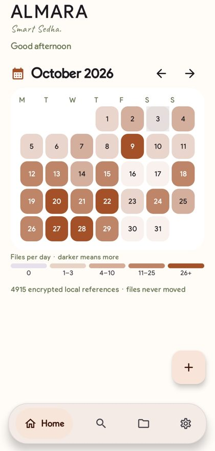
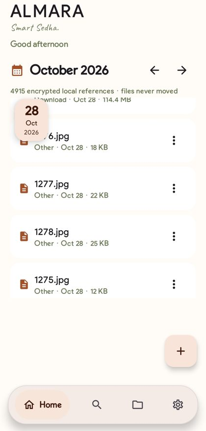
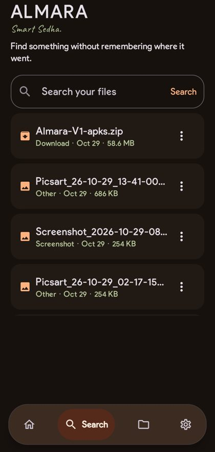
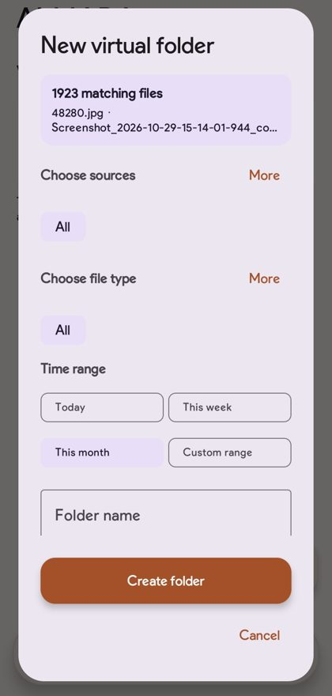
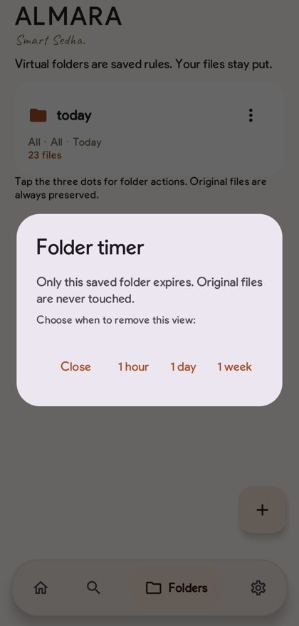
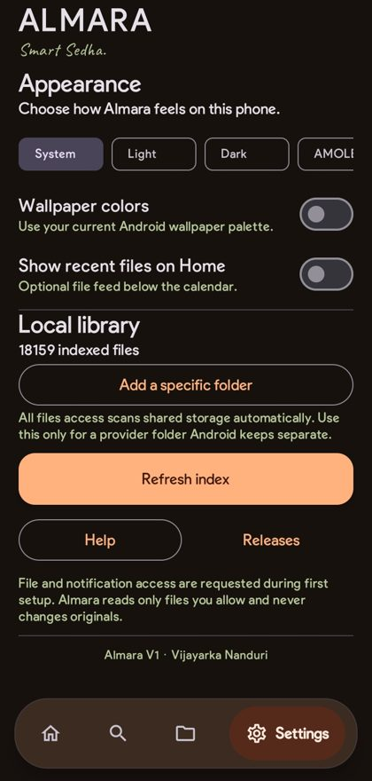

<div align="center">


# Almara

### Smart Sedha. Almara sedha karo.

Your phone is a messy cupboard. Find any file by when you got it, where it came from, or what it is. Nothing gets moved. Nothing leaves your phone.

[](LICENSE)
[](https://github.com/vijayarkananduri/Almara/releases)
[](#built-with)
[](https://github.com/vijayarkananduri/Almara)
[](#dont-trust-us-check)
[](#dont-trust-us-check)


[**Download for Android**](https://github.com/vijayarkananduri/Almara/releases) · [**How to use it**](https://vijayarkananduri.github.io/Almara/help.html) · [**Website**](https://vijayarkananduri.github.io/Almara/)

</div>

---

## Why Almara?

In many homes, someone says it every few weeks: *almara sedha karo.* Tidy the cupboard.

Almara does that for your phone without taking a single thing out of it. It gives your local files a calendar, a search bar and virtual folders, and leaves every original exactly where it was.

*Maa would be proud.*

## See it

<div align="center">

| Heatmap calendar | One day, full screen | Search |
|:---:|:---:|:---:|
|  |  |  |

| Folder builder | Folder timer | Your look |
|:---:|:---:|:---:|
|  |  |  |

</div>

## Everything it does

**Heatmap calendar.** Busy days glow. Tap one to open its files. Remember when, not where.

**Virtual folders.** Combine source, type, date and name. Save the rule as a folder. Files never move.

**Folder timer.** Let a folder vanish after an hour, a day or a week.

**Search.** Find something without remembering where it went.

**Your look.** System, Light, Dark and AMOLED, plus wallpaper colors.

**Local library.** Add a specific folder or refresh the index any time.

**Private by design.** No account, no cloud, no analytics.

**Voice search.** Coming soon. Say it, get the filter.

## Filter like you shop online

Pick a source, a type and a time range, watch the count shrink, then save the rule as a folder. Nothing is copied or moved.

| Filter | Options |
|---|---|
| Source | All, WhatsApp, Telegram, Camera, Screenshot, Download |
| File type | All, Images, Videos, PDFs, Docs |
| Time range | Today, This week, This month |
| Expires | Never, 1 hour, 1 day, 1 week |

## Don't trust us. Check.

Almara has no account, no cloud sync and no analytics. The app declares no internet permission, so it has no way to send your files anywhere. The source is open under the MIT license.

| | |
|---|---|
| **No internet** | No network permission in the app. |
| **Stays put** | Originals are never moved, renamed or copied. |
| **Encrypted index** | The index and saved views live on your phone. |
| **Open source** | Read every line. You are looking at it. |

## Get Almara

Free and open source.

1. Open [**Releases**](https://github.com/vijayarkananduri/Almara/releases) and download the latest APK.
2. Installing outside the Play Store? Android may ask you to allow it once. The [guide](https://vijayarkananduri.github.io/Almara/help.html) shows where.
3. Open Almara and pick the folders you want it to index.

> 

## Build from source

```bash
git clone https://github.com/vijayarkananduri/Almara.git
cd Almara
./gradlew :app:assembleDebug
```


## Built with

Kotlin, Jetpack Compose, WorkManager for indexing and expiry, encrypted local metadata.

## Contribute

Issues, ideas and pull requests are welcome.

1. Fork the repo
2. Create a branch: `git checkout -b feature/my-idea`
3. Commit your changes
4. Open a pull request

## License

[MIT](LICENSE). Use it, change it, share it.

---

<div align="center">

**Maa would be proud.**

[Guide](https://vijayarkananduri.github.io/Almara/help.html) · [Source](https://github.com/vijayarkananduri/Almara) · [Releases](https://github.com/vijayarkananduri/Almara/releases) · [Built by Vijayarka](https://vijayarka.netlify.app/)

© 2026 Vijayarka Nanduri. Released under the MIT license.

</div>
